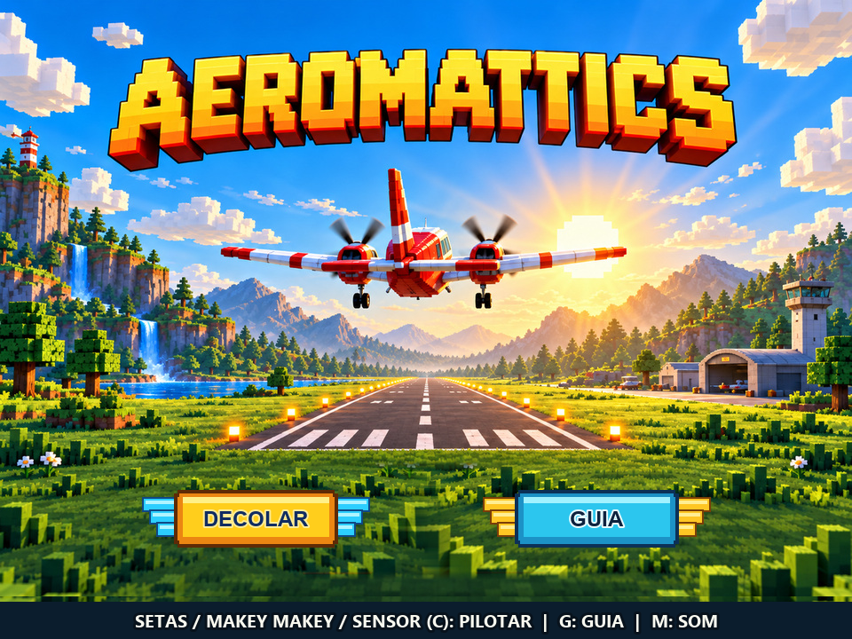

<p align="center">
  
</p>

<h1 align="center">AeroMattics</h1>

<p align="center">
  Simulacao aerea terapeutica em Scratch 3.0 para reabilitacao motora suave na Doenca de Parkinson e ensino pratico de modelagem matematica, com mundo procedural Mode-7 continuo e fauna 3D Voxel brasileira.
</p>

<p align="center">
  
  
  
  
  
  
</p>

---

## Visao Geral

O **AeroMattics** integra exercicios motores de baixa sobrecarga cognitiva a modelagem matematica aplicada. Toda a fisica de voo, atenuacao de tremor (`4 Hz` a `6 Hz`), economia de combustivel, separacao modular em 5 raias radiais e renderizacao em perspectiva Mode-7 executam de forma sincrona a `30 FPS` sem exibir formulas distrativas na tela do jogador.

- **4 Biomas Brasileiros (`4 x 40 s = 160 s`):** Amazonia (`Arara-Vermelha 3D`, `Acaizeiro 3D`), Cerrado (`Tucano-Toco 3D`, `Ipe-Amarelo`), Pantanal (`Tuiuiu Pantaneiro 3D`, `Chalana`) e Mata Atlantica (`Arara-Azul 3D`, `Palmeira Real 3D`), alem de bandos migratorios da `Harpia Real`.
- **Acessibilidade Motora:** suporte a Setas, `A/D`, Makey Makey, **Modo Sensor (`C`)** via cursor/touchpad, **Tela Guia (`G`)** e controle de audio (`M`).

---

## Documentacao Oficial

- **[Documentacao Tecnica Completa (PDF)](documentacao_pdf/AeroMattics_MIT_Parkinson_Documentacao_Completa.pdf)**: Dossie completo com equacoes, auditoria Mode-7, comparativos antes/depois e inventario de `33 targets`.
- **[Guia Rapido Clinico e Pedagogico (PDF)](documentacao_pdf/AeroMattics_Guia_Rapido_Clinico_e_Pedagogico.pdf)**: Manual de consulta rapida para terapeutas, docentes e avaliadores.
- **[Especificacao Tecnica (Markdown)](documentacao_pdf/DOCUMENTACAO_AEROMATTICS_MIT_PARKINSON.md)**: Detalhamento das formulas, playtests de `160 s` e arquitetura em Scratch 3.0.
- **[Mundo Procedural 2.5D (Markdown)](documentacao_pdf/DOCUMENTACAO_MUNDO_PROCEDURAL_25D.md)**: Modelagem do rio continuo em polilinha de `18` nos e conforto visual anti-tontura.

---

<details>
<summary><strong>Estrutura de Diretorios</strong></summary>

```text
AeroMattics/
|-- AeroMattics.sb3                                  # Pacote Scratch 3.0 principal (33 targets, 166 assets)
|-- AeroMattics_MIT_Parkinson.sb3                    # Pacote Scratch 3.0 sincronizado para avaliacao e testes
|-- AeroMattics_MIT_Parkinson_Documentacao_Completa.pdf
|-- README.md                                        # Este arquivo
|-- .gitignore                                       # Exclusao de videos brutos, zips e backups locais
|-- assets_organizados/                              # Sprites, cenarios e fauna 3D Voxel tratados
|-- documentacao_pdf/                                # Documentacao tecnica em Markdown, PDFs e imagens
|   |-- imagens/                                     # Capturas reais de gameplay e paineis matematicos
|   |-- AeroMattics_MIT_Parkinson_Documentacao_Completa.pdf
|   |-- AeroMattics_Guia_Rapido_Clinico_e_Pedagogico.pdf
|   |-- DOCUMENTACAO_AEROMATTICS_MIT_PARKINSON.md
|   |-- DOCUMENTACAO_MUNDO_PROCEDURAL_25D.md
|   |-- PLANO_CENARIO_ANIMADO_PARALLAX.md
|-- prints_telas/                                    # Capturas de tela validadas do projeto
|-- scripts/                                         # Pipeline deterministica de build, VM e testes
    |-- build_aeromattics.py                         # Compilador programatico do .sb3
    |-- build_documentacao_pdf.py                    # Gerador dos PDFs oficiais em A4
    |-- generate_assets_naturais.py                  # Geracao e limpeza de assets 3D Voxel
    |-- render_prints_aeromattics.py                 # Renderizacao de capturas e paineis
    |-- scratch_vm_sim.py                            # Simulador deterministico de VM Scratch 3.0
    |-- test_aeromattics.py                          # Suite automatizada de regressao (20 testes)
```

</details>

<details>
<summary><strong>Como Executar Localmente</strong></summary>

### 1. Jogar no Scratch 3.0 / TurboWarp
1. Abra o [TurboWarp](https://turbowarp.org/) ou o editor oficial do Scratch 3.0.
2. Carregue o arquivo `AeroMattics_MIT_Parkinson.sb3` (ou `AeroMattics.sb3`).
3. Pressione `DECOLAR` (ou `Espaco`) para iniciar, `G` para abrir a Tela Guia, `C` para ativar o Modo Sensor e `M` para silenciar o audio.

### 2. Recompilar e Validar via Python
Requisitos: Python `3.11+` com `pillow`, `reportlab`, `matplotlib` e `pypdf`.

```bash
# Executar a suite completa de testes na VM Scratch deterministica
python scripts/test_aeromattics.py

# Recompilar o pacote .sb3 a partir dos scripts e assets
python scripts/build_aeromattics.py

# Recompilar os PDFs oficiais em documentacao_pdf/
python scripts/build_documentacao_pdf.py
```

</details>

<details>
<summary><strong>Arquitetura Matematica e Validacao</strong></summary>

- **Filtro Passa-Baixa Anti-Tremor (`30 FPS`):** `vx(t) = 0.82 * vx(t - 1) + 0.18 * alvo(t)`, com passo lateral limitado a `[-2.10, +2.10]` px/frame.
- **Raias Radiais Disjuntas:** `p(d) = d^1.65`, `Y = 44 - 148 * p`, com separacao modular `Ave = S mod 5`, `Comb = (S + 2) mod 5` e `Brisa = (S + 4) mod 5`.
- **Motor Pen Mode-7 Continuo:** `296` tracos/quadro dentro de bloco `warp=true`, polilinha continua de `18` nos para o rio e `8` filetes de correnteza em `mod(Z_Mundo * 2.1, 24)`.
- **Regressao Automatizada:** validado por `scripts/test_aeromattics.py` em VM Scratch deterministica.

</details>

---

## Autor

<p align="center">
  <a href="https://github.com/ThyagoToledo">
    
    <br />
    <sub><b>ThyagoToledo</b></sub>
  </a>
</p>
