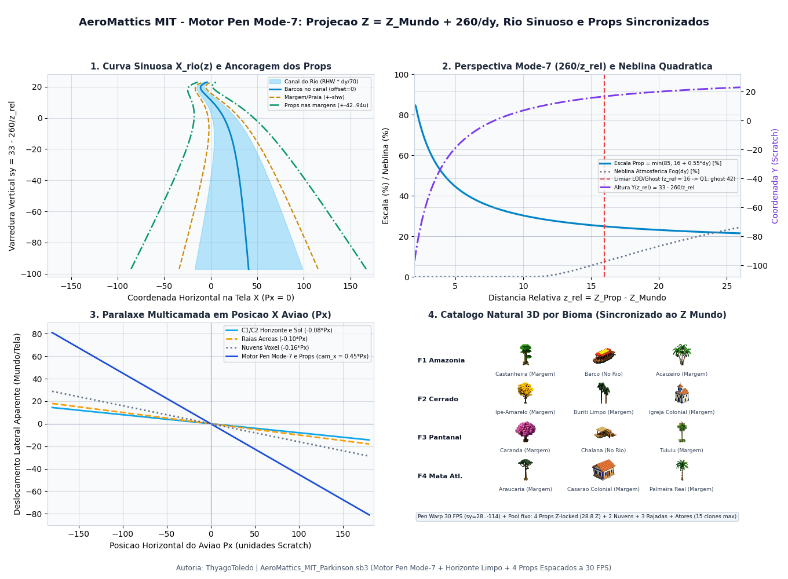
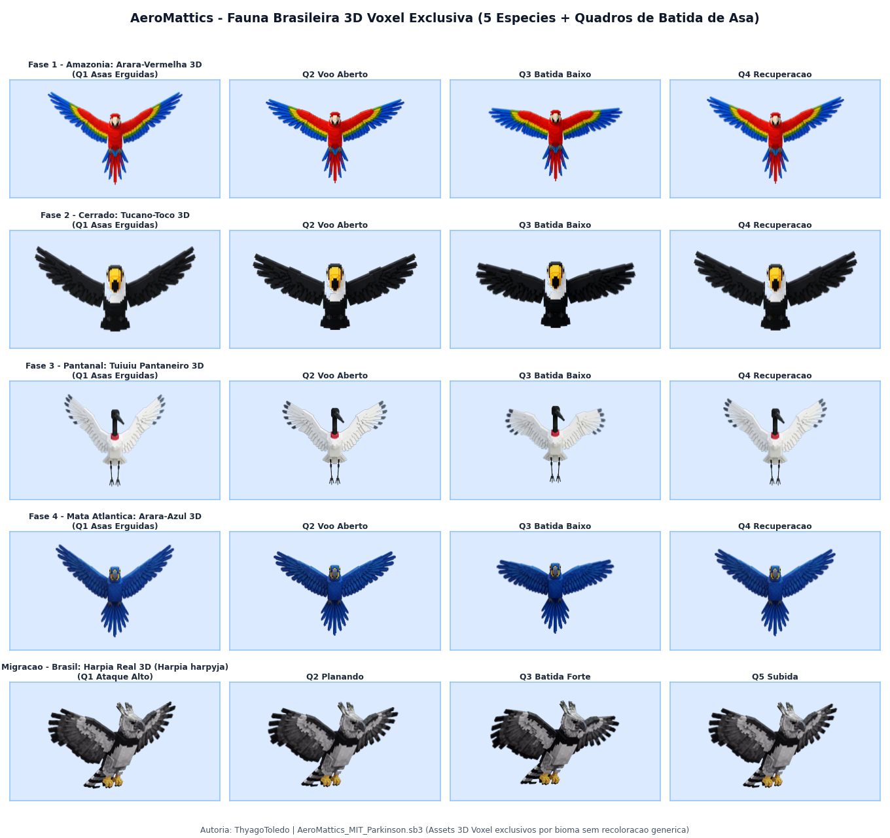

# Arquitetura Executada — Cenario Proprio Animado em 4 Biomas Brasileiros, Perspectiva 2.5D/Mode-7 e Fauna 3D Exclusiva

**Autoria exclusiva:** ThyagoToledo  
**Projeto:** AeroMattics (`AeroMattics_MIT_Parkinson.sb3`)  
**Status:** Implementado, auditado em VM a `30 FPS` e validado com `33 targets`, `166 assets`, `23,930,082 bytes` e **`20/20` testes aprovados (`OK`)**

---

## 1. Objetivo Alcancado

Os antigos fundos genericos e props desalinhados foram substituidos por uma arquitetura multicamada coesa para os **4 Biomas do Brasil** (`Amazonia`, `Cerrado`, `Pantanal` e `Mata Atlantica`), unindo:

- **Horizonte limpo e Sol Voxel (`cenario`, `Sol`):** panoramas nitidos `bioma1..4_vivo_q1..3.png` sem sobreposicao sobre o canal d'agua, paralaxe suave `-0.08 * Px` e `Sol` em `(172, 130)` (`48%`, `ghost = 8`).
- **Ceu alto confinado (`Nuvens`):** pool fixo de `2` clones restritos a faixa superior `y in [+82, +138]` (`18%..38%`, `ghost = 28`), sem obstruir o aviao nem o rio.
- **Motor Pen Mode-7 continuo (`Terreno Procedural`):** campos calmos de baixo contraste (`<= 14 RGB`, zero xadrez central anti-tontura), **rio em polilinha conectada de `18` nos** (areia + agua rasa turquesa + canal profundo azul) e **`8` filetes de correnteza em loop periodico (`flux = mod(Z_Mundo * 2.1, 24)`)**.
- **Marcos 3D Voxel espacados (`Vegetacao e Cenario Vivo`):** pool enxuto de `4` clones presos a `Z Mundo` em ciclo `28.8 Z` (maximo de `1` barco por ciclo no canal `slot == 1` sem placa ciano), incluindo **Acaizeiro 3D (`b1_prop3`, substituindo a antiga ponte)** na Amazonia e **Palmeira Real 3D (`b4_prop3`, substituindo o antigo barco com cachoeira)** na Mata Atlantica.
- **Fauna Brasileira 3D Exclusiva (`Passaros` e `Aves Migratorias`):** sprites esculpidos em 3D Voxel unicos por bioma (`Arara-Vermelha`, `Tucano-Toco`, `Tuiuiu Pantaneiro`, `Arara-Azul`) com batida de asa fluida (`0,11 s`), mais bando de **`3` Harpias Reais 3D** 100% opacas e orientadas bilateralmente (`+90` direita / `-90` esquerda) mantendo o corredor oposto livre (`|X| >= 25`).

---

## 2. Modelos Matematicos Principais

- **Perspectiva de solo e rio (`Terreno Procedural` e props):**
  `dy = max(2, 33 - sy)`, `z_rel = 260 / dy`, `X_rio(z_w) = 42 * sin(12.6 * z_w + 63 * Etapa + 3.6 * 42) + 18 * cos(6.3 * z_w)`, avancando a `Z Mundo += 0.10 + 0.01 * Etapa` por frame (`30 FPS`).
- **Cinco Raias Radiais no ar (`p(d) = d^1.65`):**
  `Y(p) = 44 - 148 * p`, `X(p) = round(-0.10 * Px) + x0 * (0.22 + 0.78 * p)` para `x0 in {-136, -68, 0, +68, +136}`, com separacao modular disjunta (`mod 5`), ciclo de ondas de `6.2 s` e surgimento atmosferico suave (`ghost` quando `d < 0.24`).
- **Controle anti-tremor para Parkinson (`Avião`):**
  filtro IIR `vx = 0.82 * vx + 0.18 * alvo` com teto `[-2.10, +2.10]` px/frame, Modo Sensor (`C`), Makey Makey, bonus de equilibrio `+1 pt/s` (`|Estabilidade| <= 12`) e garantia adaptativa de combustivel (`Combustivel < 35%`).

